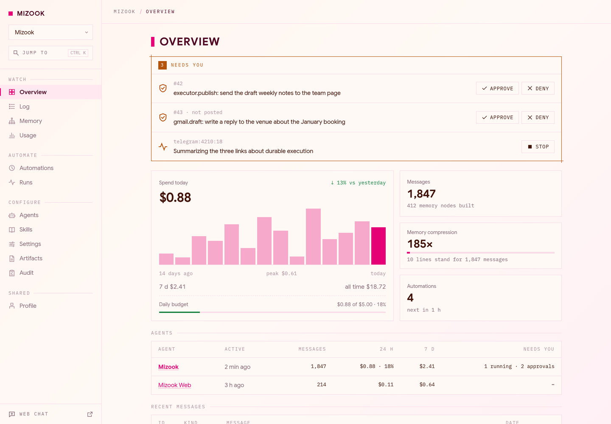
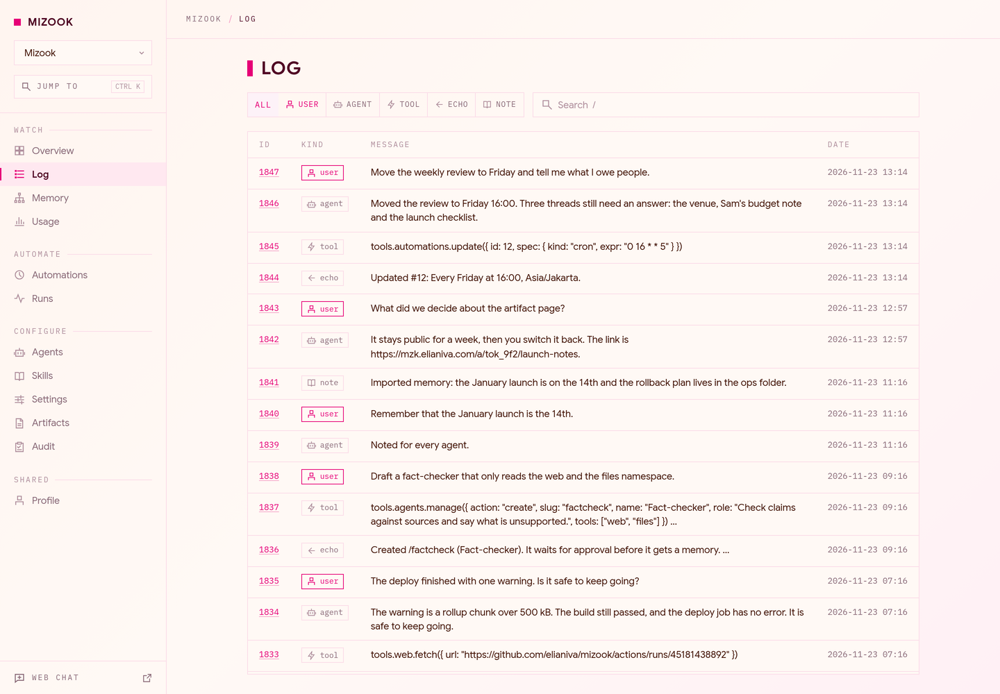
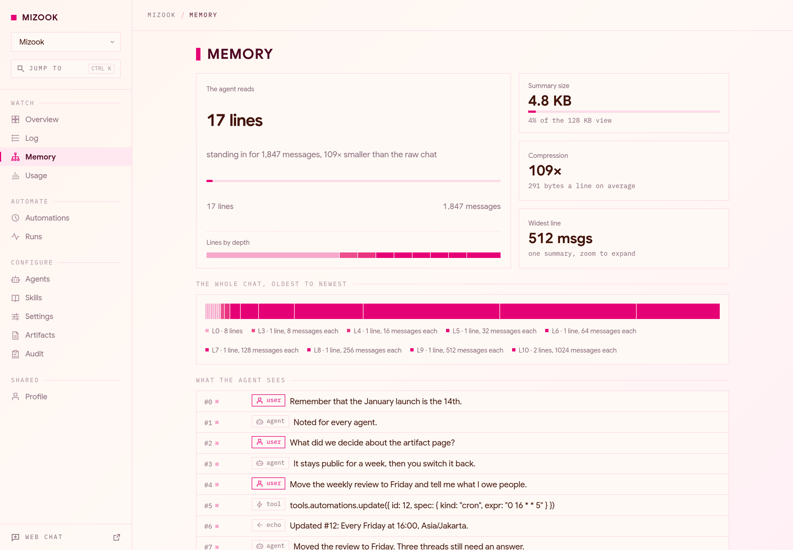
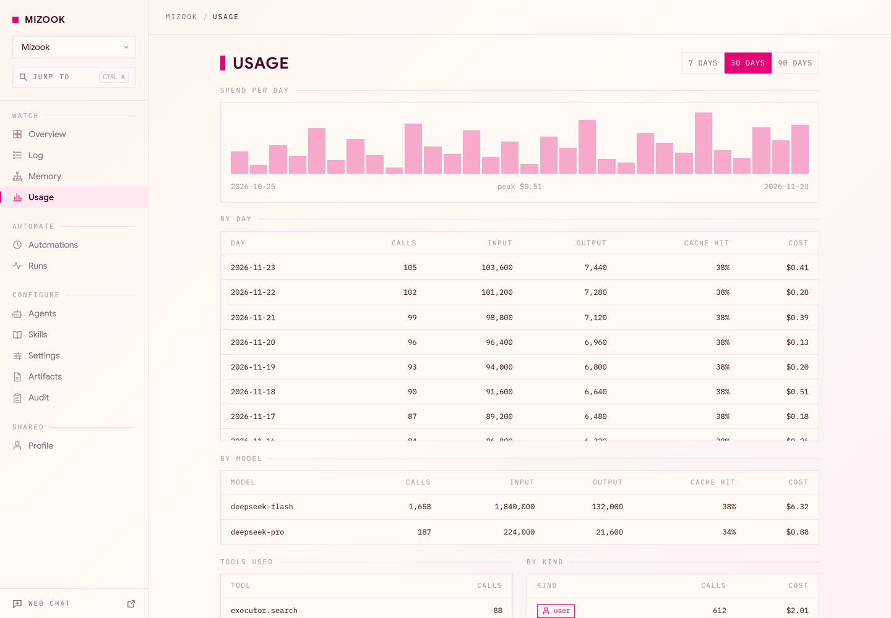
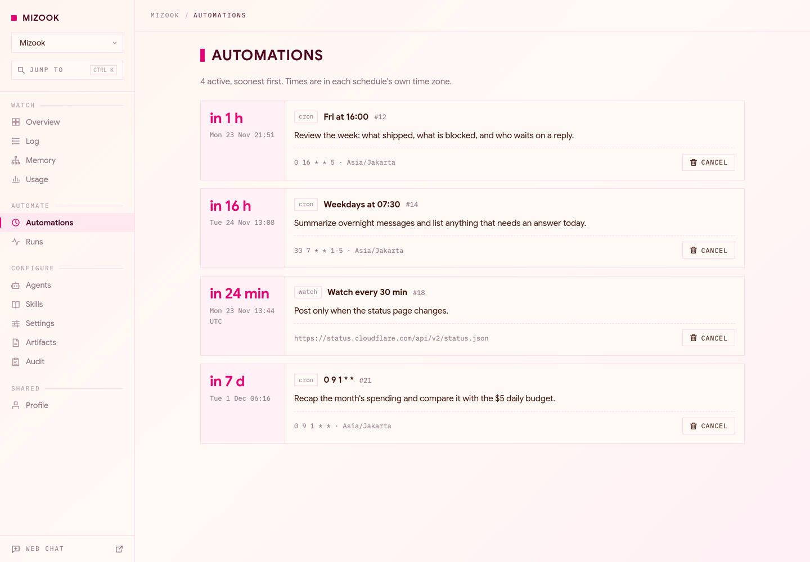
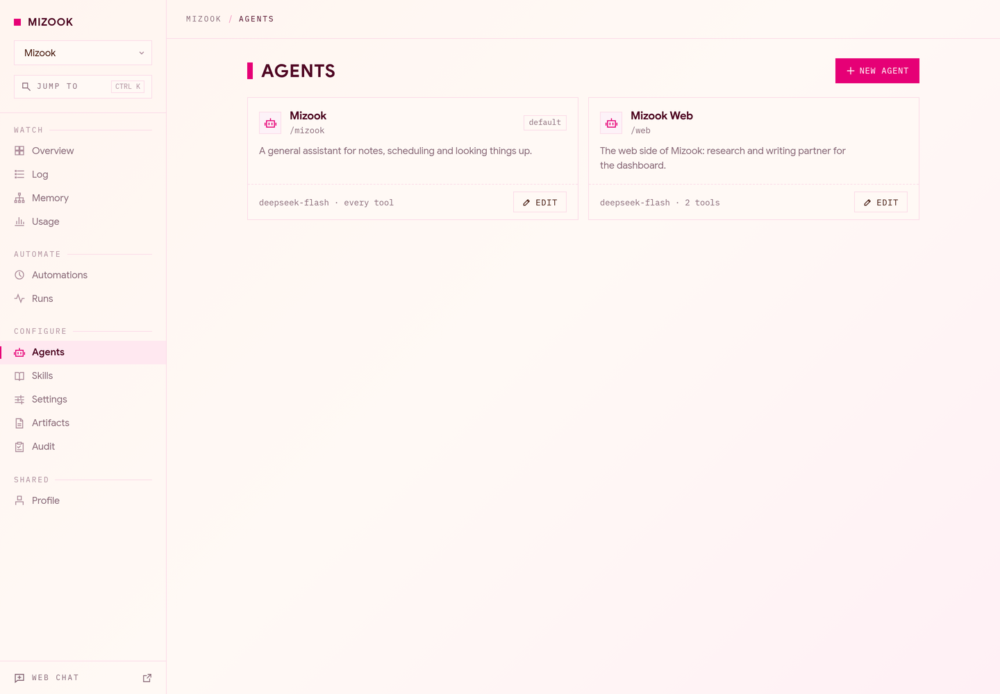
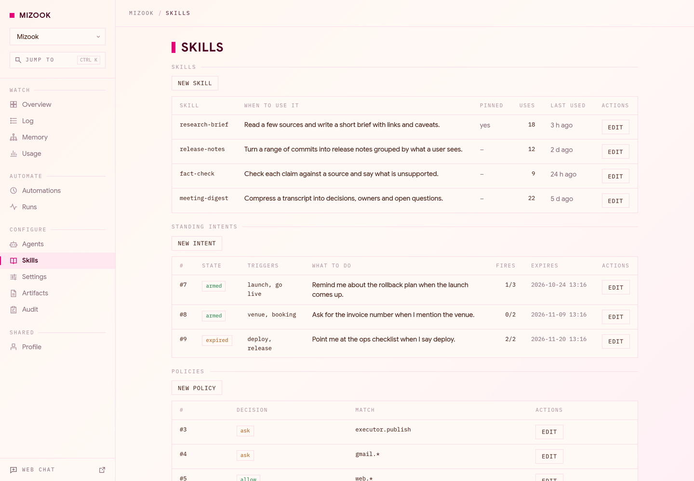
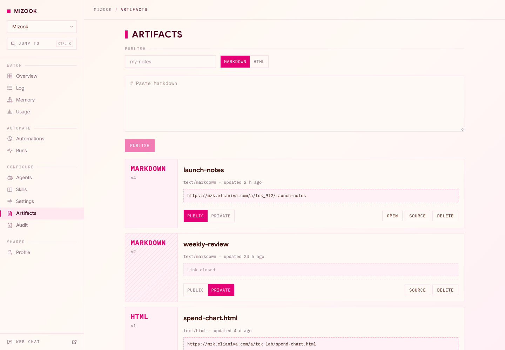

<h1 align="center">
  <picture>
    <source media="(prefers-color-scheme: dark)" srcset="docs/logo-dark.svg" />
    
  </picture>
</h1>

A personal assistant in Telegram and on the web, on Cloudflare Workers. It is one or more agents,
each a chat that never ends: an agent remembers everything said to it in every topic it answers in,
and nothing needs resetting.

- **Memory** — [`@mizook/memory`](packages/memory): the whole chat is logged word for word and
  compressed into a binary tree of one-line summaries. Each turn sees a constant-size view of it
  and zooms where it needs more. A full-text index finds exact words when the summary is too
  coarse. See the [package README](packages/memory/README.md).
- **Agent** — [`@earendil-works/pi-durable`](https://www.npmjs.com/package/@earendil-works/pi-durable):
  every turn is a durable run. Model calls and tool calls are committed to the Durable Object's
  SQLite before anything is shown, so a restart picks the turn up where it stopped.
- **Telegram** — [Chat SDK](https://chat-sdk.dev) with the Telegram adapter.
- **Web chat:** [`apps/web`](apps/web) is a full-page chat at `https://mzk.elianiva.com`. It has its own `web` agent and a thread list from the Hub. Foldkit holds the state, `@mizook/ui` supplies the interactive behaviors, and `@mizook/design` supplies the Panda preset both apps use.
- **Deploy** — [Alchemy](https://alchemy.run), declared in `alchemy.run.ts`.
- Everything is [Effect](https://effect.website): services, layers, typed errors.

```
Telegram ─webhook─▶ Worker (src/worker.ts)            checks the secret, asks the Hub which agent
                       │                               the place, command or button is for, then
                       ▼
                    AgentObject Durable Object (src/agent-object.ts)       one agent = one object
                       ├─ Bot      Chat SDK ⇄ Telegram
                       ├─ Agent    one pi-durable conversation per turn
                       ├─ Memory   log, tree, view, compactions         (packages/memory)
                       └─ SQLite   pi-durable + memory + bot state, one connection
```

## Features

- **Code mode:** the model has two tools, `send_to_user` and `execute`. Everything else is a `tools.<namespace>.<name>` function that a JavaScript program calls, run by [`@opencode/codemode`](https://github.com/anomalyco/opencode/tree/dev/packages/codemode). The system prompt lists each tool in one line, and `search(query)` gives the full signature, so no tool schema is sent per call. One program can chain many calls, and a role's tool list hides the rest.
- **Agents:** each agent is one Durable Object with its own memory and settings. Every topic, group and DM talks to the default agent until `/agent <slug>` binds it to another. `/<slug> …` sends one message to that agent from anywhere, and a reply to a message brings the message along. `/agents` lists them; `tools.agents.ask` reads another one's memory, read-only. `/name` names the place you are in. An agent can have a role (instructions for what it is for), its own persona, a model, and a list of the only tools it gets, by path or namespace. Ask an agent to make a new one, such as a fact-checker: `tools.agents.manage` creates, changes or deletes agents after you approve, and the bot menu lists every agent's `/<slug>`.
- **Profile:** a short "about you" and the rules to follow, shared by every agent. `/profile` shows it; the agent updates it when it learns a stable preference.
- **Skills:** reusable procedures the agent saves after a repeatable task and reads by name. An agent's own skills are its alone; global skills live in the Hub and every agent sees them. An agent's own skill wins over a global one of the same name. An automation can name a skill to read when it fires; a pinned skill cannot be deleted while an automation needs it.
- **Standing intents:** "when I mention the launch, remind me about rollback" waits for trigger words in a later message. Matching is a token scan, not a model call; `/intents` lists them.
- **Automations:** a trigger and an action, kept in one `Automations` Durable Object for every agent. Triggers are `once`, `cron`, `watch` (polls a URL, fires only when it changes) and `webhook` (a secret `/hook/<id>/<token>` link other services POST to). Actions are a turn of any agent in any place, a fixed message posted with no model call, or a call to an outside https URL with the trigger's payload in its body. `/automations` lists them and pauses, resumes, tests or cancels one by number; `/runs` shows the last ten and why one failed. Each agent is capped at 20 automation turns an hour.
- **Artifacts:** pages and files at `https://mzk.elianiva.com/a/<token>/<name>`, sandboxed. Versions are kept in R2.
- **Web:** `tools.web.search` (Parallel, then Exa; set `SEARCH_PROVIDERS`) and `tools.web.fetch`. For pages that need JavaScript, `tools.web.render` renders them with Cloudflare Browser Rendering and returns markdown plus a screenshot link.
- **Executor:** the `tools.executor` namespace over MCP: skills, search, describe, call and execute. A call that needs approval shows Approve, Always allow and Deny buttons in the chat; the press resumes it and the agent sees the result. `/policies allow|ask|deny <match>` sets standing rules, and an approval expires after 30 minutes. Use the plain `/mcp` URL (model mode).
- **Files:** attachments are stored. Text is read directly, voice notes are transcribed, images are described, and PDF or Office files are converted by Workers AI. `tools.files.read` reads a stored one later.
- **Receipt:** a 👀 reaction means the message reached the bot. Typing starts when the model does, so an eye without typing is a slow model, not a lost message.
- **Commands:** `/stop /cost /model /instructions /timezone /budget /agent /agents /name /profile /skills /intents /policies /automations /runs /export`, plus `/<slug>` for each agent.
- **Portability:** `/export` gives a tar in the design's layout (`main/`, `tree/`, `view.json`) plus `skills.json`, `intents.json`, `policies.json`, `settings.json` and artifacts. A nightly backup of every agent goes to R2 (14 kept).

## Setup

```sh
vp install
cp .env.example .env     # then fill it in
```

| Variable                          | Required | What                                                                              |
| --------------------------------- | -------- | --------------------------------------------------------------------------------- |
| `BOT_TOKEN`                       | yes      | Telegram bot token from @BotFather                                                |
| `MIZOOK_WEBHOOK_SECRET`           | yes      | Any random string; Telegram sends it back with every update                       |
| `DEEPSEEK_API_KEY`                | yes      | [DeepSeek](https://platform.deepseek.com) API key                                 |
| `PARALLEL_API_KEY`, `EXA_API_KEY` | no       | Web search keys, tried in `SEARCH_PROVIDERS` order (default `parallel,exa`)       |
| `EXECUTOR_URL`, `EXECUTOR_TOKEN`  | no       | Executor MCP endpoint (`https://mcp.executor.sh/mcp`) and a personal access token |
| `BUDGET_DAILY`                    | no       | Dollars an agent may spend in 24 hours; 0 or unset is no limit                    |
| `TELEGRAM_ALLOWED_USER_IDS`       | yes      | Comma-separated Telegram user ids. Nobody else gets an answer                     |
| `MODEL`                           | no       | The agent's model (default `deepseek-flash`)                                      |
| `SUMMARY_MODEL`                   | no       | The cheap model that writes the memory (default `deepseek-flash`)                 |
| `AGENT_NAME`                      | no       | The default agent's name, set when the Hub creates it (default `Mizook`)          |
| `INSTRUCTIONS`                    | no       | Who you are and how you want work done: goes last in the system prompt            |
| `TIMEZONE`                        | no       | IANA zone for the dates the agent sees (default `Asia/Jakarta`)                   |

Message the bot before you know your id: it answers a stranger with their Telegram id.

## Deploy

Alchemy needs `CLOUDFLARE_ACCOUNT_ID` and `CLOUDFLARE_API_TOKEN` (or a profile: `alchemy profile`).

```sh
vp run deploy            # alchemy deploy: Worker + AgentObject Durable Object
vp run webhook https://<the url deploy printed>
```

`vp run dev` runs the same stack under `alchemy dev`. `vp run destroy` tears it down.

## Develop

```sh
vp check          # format, lint and type-check, all on tsrs
pnpm typecheck    # whole-program tsrs check plus effect-tsrs Effect diagnostics
vp test           # the Worker, dashboard, chat and memory tests
pnpm run build    # build the chat and dashboard into dist/
```

## CI and deploy

`.github/workflows/ci.yml` runs check, typecheck and test on every push. A push to `master` then runs
`alchemy deploy --stage prod`. Set these in the repository's `production` environment:

| Kind      | Names                                                                                                                                 |
| --------- | ------------------------------------------------------------------------------------------------------------------------------------- |
| Secrets   | `CLOUDFLARE_API_TOKEN`, `BOT_TOKEN`, `MIZOOK_WEBHOOK_SECRET`, `DEEPSEEK_API_KEY`, `PARALLEL_API_KEY`, `EXA_API_KEY`, `EXECUTOR_TOKEN` |
| Variables | `CLOUDFLARE_ACCOUNT_ID`, `TELEGRAM_ALLOWED_USER_IDS`, `EXECUTOR_URL`, `INSTRUCTIONS`, `BUDGET_DAILY`                                  |

Each name may be a secret or a variable; the workflow reads both.

The deploy job points Telegram at the Worker after each deploy. To do it by hand: `vp run webhook https://mzk.elianiva.com`.

## Dashboard

The dashboard at `/admin` is the operator's view of each agent. It reads only `/admin/api`, a JSON API that the Worker serves next to the dashboard's static build. Most pages are per agent, and the agent menu keeps the section you are on while you switch.

### Overview



Overview answers two questions first: what needs you, and what it costs. Approvals and running turns sit in the "Needs you" panel with Approve, Deny and Stop. Below it are spend today with a 14-day sparkline, the daily budget meter, message and memory counts, the compression ratio, the next automation, a table of every agent, and the most recent messages.

### Log



The log holds the whole chat, word for word. Filter by kind (user, agent, tool, echo or note), search the text, and open a row for the full message. A tool call and its result are separate rows, so a program that makes ten calls is easy to follow.

### Memory



The memory page shows how the chat becomes a handful of lines. It reports the view against the 128 KB budget and gives the compression ratio, then maps the whole chat from oldest to newest, colored by depth. The list below shows each line the agent reads, its message range, and the original words at depth 0. Higher levels say how many messages they cover.

### Usage



Usage shows calls, input, output, cache hits and cost for 7, 30 or 90 days. A bar chart plots spend per day with the peak, then tables break the same range down by day, model, tool and message kind.

### Automations



Automations are listed soonest first. Each card shows the countdown, the trigger kind and cadence, the prompt, the raw spec, and a Cancel action. The Runs page keeps the last 25 executions with their status, duration and error. Each agent is capped at 20 automation turns an hour.

### Agents



Each agent gets a card with its name, `/slug`, role, model, tool count and a `default` badge. New agent is the primary action in the title row. The editor sets the name, command, role, model, persona, and the only tools the agent may use. An empty tool list gives it every tool. Deleting an agent asks for a second click, and the default agent cannot be deleted.

### Skills, intents and policies



One page holds the three things an agent learns. Skills list when to use them, whether they are pinned, how often they ran and when they last ran. Standing intents show their state, trigger words, fire count and expiry. Policies set `allow`, `ask` or `deny` for a tool match. Each table has an editor for its rows.

### Artifacts



Publish Markdown or HTML from the page, then manage every artifact the agent owns. A card shows the kind, version, content type, update time, link and visibility. Public artifacts open at their URL, private ones keep the link closed, and Source shows the stored text. Versions live in R2.

### Settings, profile and audit

Settings edits the agent's model, daily budget, time zone and extra instructions through the same code as the slash commands. Profile holds the about-you text and the rules every agent shares. Audit lists each write made from the dashboard with the person, action, target and result.

Dashboard writes update the page before the request lands and roll back if the API rejects it. Every POST is same-origin and carries an `x-mizook-csrf` header, the Worker checks the Access token on every admin request, and writes are recorded in the agent's `app_audit` table. The app is Foldkit with Panda's `css()`: warm paper, dark ink, a magenta accent, square corners and hairline borders. It follows the system light or dark theme, and the rail becomes a menu on narrow screens.

`Ctrl K` (or `⌘K`) opens a jump menu for every section and every agent. `g` followed by `o` (overview), `l` (log), `m` (memory), `u` (usage), `a` (automations), `r` (runs), `k` (skills), `e` (agents), `s` (settings), `f` (artifacts), `t` (audit) or `p` (profile) goes there directly.

To work on the dashboard, run `pnpm --filter @mizook/dashboard dev`. It proxies `/admin/api` to `ADMIN_API` (default `http://localhost:8788`).

## Web chat

The web chat lives at `/c`. The Worker redirects `/` to `/c`. One `WebChat` Durable Object owns the thread list and every transcript. The browser keeps a replica in IndexedDB and talks to that source over an Effect RPC WebSocket at `/c/sync`. The agent appends its bubbles and turn status through the same source actions, so the order the browser reads is the order the agent wrote. The old `web_messages` and `web_threads` tables are read once when the source initializes. Threads are places named `web:<id>`, so one web agent shares its memory across every web thread.

The chat installs as a PWA: `/manifest.webmanifest` names it, and a service worker at `/sw.js` with scope `/c` precaches the shell, so an installed copy opens offline. The synced replica lives in IndexedDB, so the saved thread list and conversations stay readable without a connection and queued actions run when the connection returns. Navigations go to the network first so Cloudflare Access can still renew a session. Only a failed fetch falls back to the cached shell. A new version takes over on the next launch, after every open copy has closed.

To work on the chat, run `pnpm --filter @mizook/web dev`. It proxies `/c/sync` to `CHAT_API` (default `http://localhost:8788`), including the WebSocket. `pnpm run build` builds both apps and assembles `dist/` as one asset directory.

## Access

Alchemy declares both Access applications and their policies (`alchemy.run.ts`), so `alchemy deploy` is the whole setup. Set these first:

- `ACCESS_TEAM_DOMAIN`: your Zero Trust team domain, `<team>.cloudflareaccess.com`.
- `ADMIN_EMAIL`: the one email both policies allow.
- `GH_CLIENT_ID` and `GH_CLIENT_SECRET` (optional): a GitHub OAuth app whose callback is `https://<team>.cloudflareaccess.com/cdn-cgi/access/callback`. Alchemy creates the GitHub login method from it. Without them, Access uses the login methods the account already has.

The dashboard application covers `/admin*`, and the web chat application covers `/c*`, so `/telegram/webhook`, `/hook`, `/a`, `/d` and `/x` stay outside both. The Worker checks the Access token itself (RS256, issuer, audience, expiry) for each application. `/admin` answers 503 while the team domain or dashboard audience is missing. The chat source answers 503 while the chat audience is missing.

## License

Mizook is licensed under GPL-3.0-only. See [LICENSE](LICENSE).
